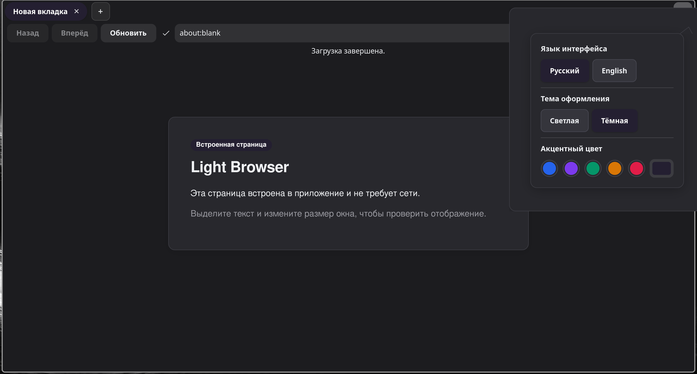
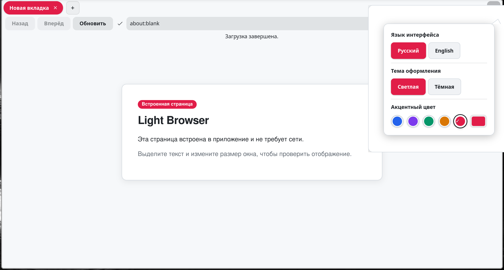
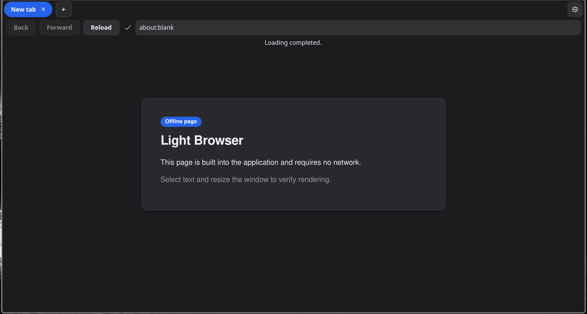
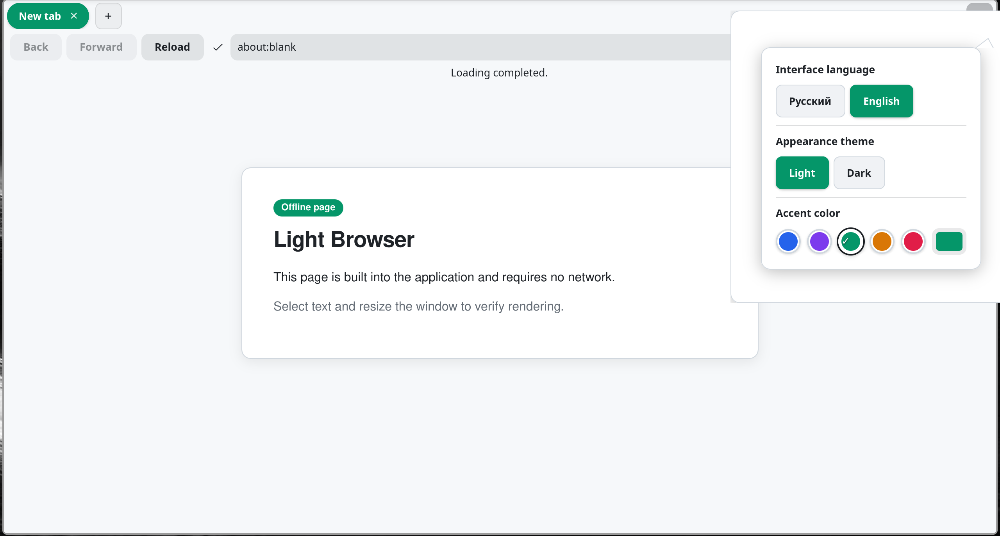
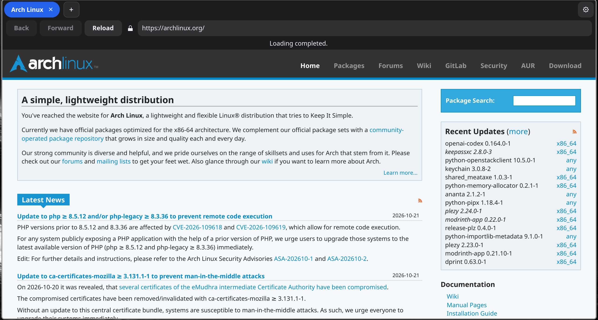

# Light

[English version](README_en.md)

**Экспериментальный, легковесный и настраиваемый браузер для Linux.**

Light — open-source веб-браузер, разрабатываемый на Rust с использованием GTK4, Relm4 и WebKitGTK. Главная цель проекта — предоставить быстрый, модульный и удобный инструмент для веб-серфинга с упором на производительность, гибкую настройку интерфейса и полный контроль пользователя над своими данными.

В настоящее время проект находится на стадии разработки **0.3-alpha**.

---

## Скриншоты

| Тёмная тема (Русский интерфейс) | Светлая тема (Русский интерфейс) |
| :---: | :---: |
|  |  |

| Тёмная тема (English interface) | Светлая тема (English interface) |
| :---: | :---: |
|  |  |

| Просмотр сайтов (Arch Linux) |
| :---: |
|  |

---

## Ключевые особенности и цели

- **Надёжность Rust** — безопасность памяти, высокая скорость работы и современный язык программирования.
- **Ориентация на Linux** — нативная работа на Wayland и X11.
- **Модульная архитектура** — строгое разделение ответственности: интерфейс (GTK4 / Relm4), ядро управления вкладками, конфигурация и адаптер WebKitGTK. (в следующих версиях)
- **Управление памятью без сюрпризов** — режим жизненного цикла вкладок Manual по умолчанию: никаких фоновых выгрузок или потери несохранённых данных сайтов. 
- **Гибкая кастомизация** — светлая и тёмная темы, палитра выбора любого акцентного цвета интерфейса, готовые цветные пресеты, переключение языка на лету, также другие настройки в следующих версиях.
- **Приватность и безопасность** — строгая политика нулевой телеметрии: никаких скрытых сетевых запросов, отправок телеметрии и трекеров.
- **WebKitGTK 6.0** — современный движок рендеринга веб-стандартов с аппаратным ускорением и изоляцией процессов.

---

## Технологический стек (кратко)

- **Язык**: Rust (Редакция 2024)
- **Графический интерфейс**: GTK4 (`gtk4` crate)
- **Реактивная UI-архитектура**: Relm4 (`relm4` crate)
- **Движок рендеринга**: WebKitGTK 6.0 (`webkit6` crate)
- **Конфигурация**: TOML (`toml`, `serde`)
- **База данных сессий и cookies**: SQLite через WebKitGTK

---

## Проделанная работа в 0.3-alpha (по сравнению с 0.2-alpha)

Версия 0.3-alpha представляет собой качественный скачок по сравнению с версией 0.2-alpha: от базового окна и предварительных элементов навигации к целостному, персонализируемому браузеру с сохранением состояния.

### 1. Капсульный дизайн вкладок
- **Вкладки в виде капсул**: каждая вкладка выполнена в виде блока со скруглением и комфортной высотой
- **Акцентная заливка**: активная вкладка полностью заливается выбранным акцентным цветом с контрастным белым текстом.
- **Обновлена кнопка закрытия вкладки (`✕`)**:
  - На неактивных вкладках кнопка скрыта и проявляется только при наведении мыши.
  - На активной вкладке видна сразу
  - Фон под кнопкой закрытия бесшовно повторяет цвет самой вкладки без зазоров и разрывов.
- **Квадратная кнопка создания вкладки (`+`)**: размещена в ленте вкладок сразу за последней открытой вкладкой в квадратных пропорциях со скруглением углов.

### 2. Долговременное хранение сессий и Cookies (SQLite)
- Интегрировано постоянное хранилище WebKitGTK на базе SQLite (`~/.local/share/light-project/cookies.sqlite`).
- Сессии авторизации, входы на сайты и cookies теперь сохраняются между перезапусками браузера.

### 3. Индикатор безопасности подключения
- Непосредственно перед адресной строкой добавлен динамический индикатор статуса соединения с поясняющими подсказками:
  - **HTTPS** — защищённое зашифрованное подключение.
  - **HTTP** — открытое незашифрованное соединение.
  - **Ошибки TLS** — предупреждение о недействительных или самоподписанных сертификатах.
  - **Внутренние страницы** — встроенные страницы Light.

### 4. Интерактивное меню настроек и персонализация
- Меню вызывается по кнопке с шестерёнкой в правом верхнем углу панели.
- **Мгновенное переключение языка (RU / EN)**: все надписи интерфейса, статусы и меню настроек обновляются сразу.
- **Темы оформления (Светлая / Тёмная)**: фоны меню, панелей и кнопок строго соответствуют выбранной теме.
- **Готовые пресеты**: 5 круглых образцов акцентных цветов: синий, фиолетовый, изумрудный, янтарный, розовый.
- **Произвольный выбор цвета**: встроенный диалог выбора любого оттенка.
- **Живое обновление стилей**: активные вкладки, кнопки настроек и встроенная страница мгновенно перекрашиваются без перезапуска.

### 5. Сохранение настроек в TOML
- Настройки пользователя сохраняются в файле `~/.config/light-project/config.toml` (язык, тема, акцентный цвет).
- Предусмотрены безопасные значения по умолчанию и защита от сбоев при чтении.

### 6. Очистка и стабилизация GTK4 CSS
- Полная совместимость с CSS-парсером GTK4: устранены несовместимые свойства и директивы, гарантируя 0 ошибок парсинга стилей.

---

## Процесс разработки

- [x] Главное окно браузера
- [x] Базовые элементы навигации (Назад, Вперёд, Обновить)
- [x] Адресная строка с автоматическим разрешением HTTPS и проверкой безопасности схем
- [x] Полноценное управление вкладками (создание, переключение, безопасное закрытие)
- [x] Капсульный дизайн вкладок с плавной кнопкой закрытия
- [x] Кнопка новой вкладки `+` в ленте вкладок
- [x] Переключение языка интерфейса (RU / EN)
- [x] Индикатор защищённости соединения (HTTPS / HTTP / ошибки сертификатов)
- [x] Меню быстрых настроек (язык, тема, быстрые цветные пресеты и палитра)
- [x] Сохранение конфигурации браузера (`config.toml`)
- [x] Долговременное сохранение cookies и авторизаций сайтов в SQLite
- [ ] Менеджер загрузок (прогресс, выбор места сохранения, отмена)
- [ ] Восстановление сессии и вкладок после перезапуска
- [ ] Графический менеджер встроенных модулей
- [ ] Политики выгрузки и усыпления неактивных вкладок (Balanced, Aggressive)

---

## Сборка и запуск

### Требования к системе

Для сборки и работы необходимы библиотеки разработки GTK4 и WebKitGTK 6.0:

- **Arch Linux / Manjaro**:
  ```
  sudo pacman -S base-devel rust gtk4 webkitgtk-6.0 pkgconf
  ```

- **Ubuntu / Debian** (24.04+):
  ```
  sudo apt install build-essential cargo libgtk-4-dev libwebkitgtk-6.0-dev pkg-config
  ```

- **Fedora**:
  ```
  sudo dnf install gcc rust cargo gtk4-devel webkitgtk6.0-devel pkgconf-pkg-config
  ```

Проверка версий системных библиотек:
```
pkg-config --modversion gtk4
pkg-config --modversion webkitgtk-6.0
```

### Запуск браузера

Склонируйте репозиторий и запустите проект через Cargo:

```
git clone https://github.com/rxmaneoff/light-browser ~/Light
cd ~/Light
cargo run --release
```

Для сборки в режиме разработки и прогона тестов:

```
cargo test
cargo run
```

---

## Участие в разработке

Проект находится на раннем этапе активного развития. Приветствуются багрепорты, предложения по интерфейсу и архитектуре!
