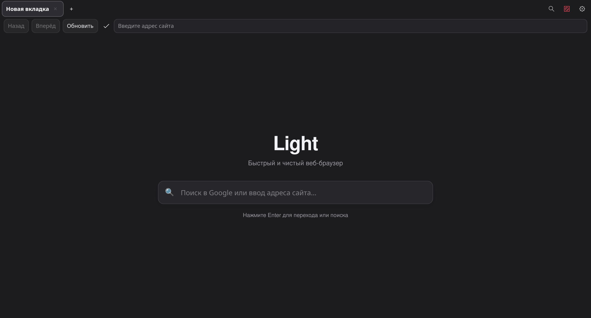
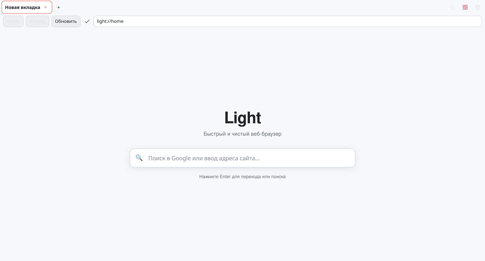
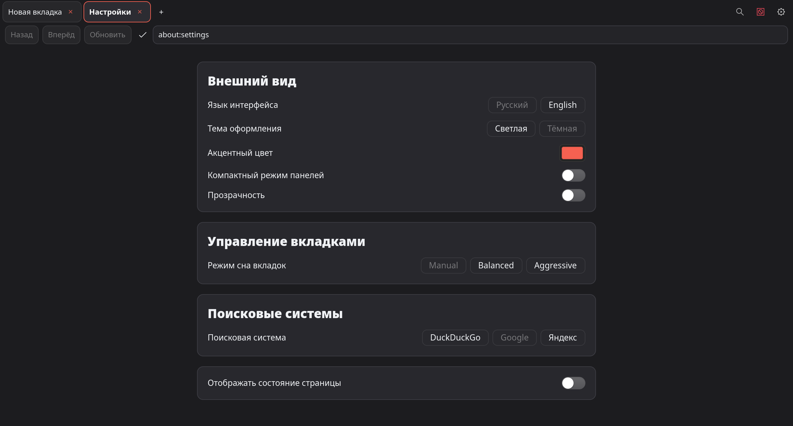
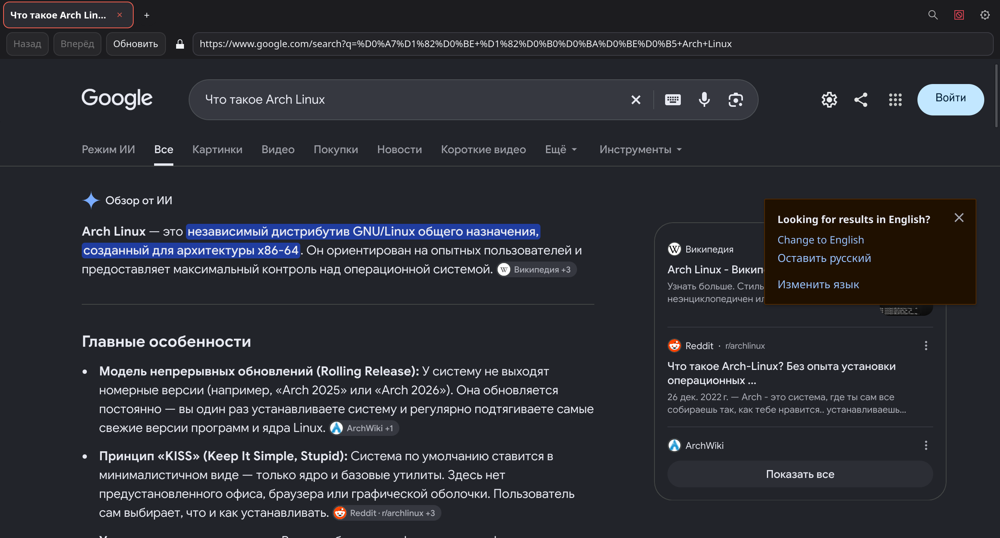

# Light

[English version](README_en.md)

**Light — браузер для Linux на Rust, GTK4, Relm4 и WebKitGTK 6.0.** Проект находится в разработке, версия 0.5-alpha.

## Скриншоты

| Тёмная тема | Светлая тема |
|:---:|:---:|
|  |  |

| Настройки | Просмотр веб-страницы |
|:---:|:---:|
|  |  |

## Возможности

- Вкладки и навигация на базе WebKitGTK; домашняя страница `light://home`.
- Светлая и тёмная темы, выбор акцентного цвета, компактный режим панелей и настройка прозрачности.
- Режимы вкладок `Manual`, `Balanced` и `Aggressive`. По умолчанию выбран `Manual`, в котором автоматическое усыпление выключено. При усыплении страница восстанавливается по URL, поэтому состояние сайта может потеряться.
- Встроенные страницы настроек и модулей: `about:settings` и `about:modules`.
- Поиск через DuckDuckGo, Google или Яндекс; внутренние адреса `light://` и `about:` обрабатываются приложением.
- Палитра команд `Ctrl+Shift+P` и локальная страница диагностики `light://performance`.
- Настройки сохраняются в TOML. Браузер не отправляет собственную телеметрию.

Встроенные модули управляют вкладками, диагностикой, оформлением, сочетаниями клавиш, состоянием соединения и разбором поисковых запросов. Модули оформления и безопасности обязательны.

## Сборка и запуск

Нужны Rust Edition 2024, GTK4 и WebKitGTK 6.0 с файлами разработки. Названия пакетов зависят от дистрибутива. Например, в Arch Linux:

```bash
sudo pacman -S base-devel rust gtk4 webkitgtk-6.0 pkgconf
cargo run --release
```

## Ограничения

Проект находится только на alpha версии. Поведение оформления зависит от GTK, окружения и композитора. Усыпление вкладки перезагружает страницу по сохранённому адресу и не сохраняет произвольное состояние JavaScript или несохранённые данные сайта.
