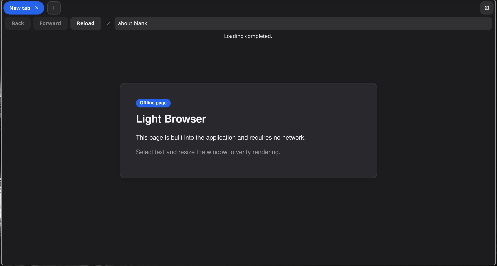
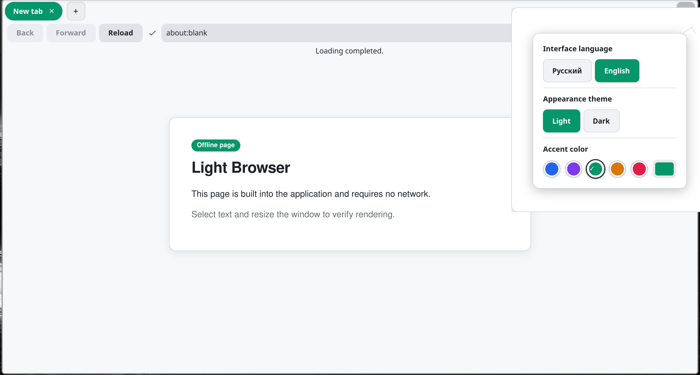
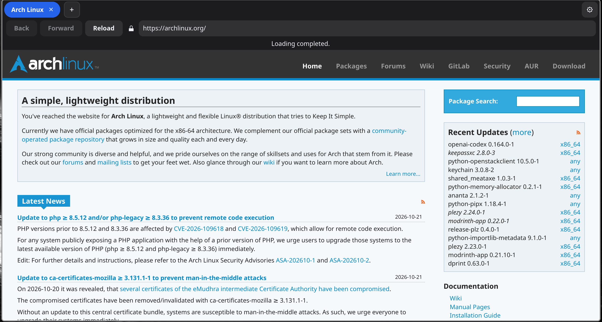

# Light

[Русская версия](README.md)

**Light is a Linux browser built with Rust, GTK4, Relm4, and WebKitGTK 6.0.** The project is in development; the current version is 0.5-alpha.

## Screenshots

| Dark theme | Light theme |
|:---:|:---:|
|  |  |

| Web page |
|:---:|
|  |

## Features

- WebKitGTK-based tabs and navigation, with `light://home` as the new-tab page.
- Light and dark themes, a custom accent color, compact toolbar mode, and transparency settings.
- Three tab lifecycle modes: `Manual` (default, no automatic sleeping), `Balanced`, and `Aggressive`. Sleeping a tab replaces its page and reloads the saved URL when resumed, so in-page state may be lost.
- Built-in settings and module pages at `about:settings` and `about:modules`.
- Search with DuckDuckGo, Google, or Yandex. The app handles `light://` and `about:` addresses internally.
- A command palette (`Ctrl+Shift+P`) and a local diagnostics page at `light://performance`.
- TOML configuration and no browser telemetry.

Built-in modules cover tab management, diagnostics, appearance, keyboard shortcuts, connection status, and search input. Appearance and security are required modules.

## Build and run

You need Rust Edition 2024, GTK4, and WebKitGTK 6.0 development files. Package names vary by distribution. For example, on Arch Linux:

```bash
sudo pacman -S base-devel rust gtk4 webkitgtk-6.0 pkgconf
cargo run --release
```

## Limitations

Light is alpha software. Appearance depends on GTK, the windowing system, and compositor. Tab sleeping reloads the saved URL; it does not preserve arbitrary JavaScript state or unsaved site data.
